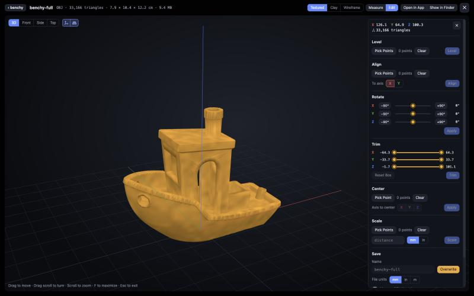

# Go ST Servo: Photogrammetry Rig

Runs a turntable photogrammetry rig from the browser: plan a capture, watch the rig move in 3D, get the photos
straight off the camera, and turn them into a 3D model. An example app of [Go ST Servo](../../README.md).

<p align="center"><b>GoSTS Rig UI</b><br></p>
<p align="center"><b>Build Model using Apple Object Capture</b><br></p>

## The rig

- Based on aluminum extrusion profiles
- Two ST3215 servos on the posts tilt a frame carrying the camera
- One ST3215 turns the platform under the object
- A camera on USB that [gphoto2](http://gphoto.org) can drive

No hardware? Both the rig and the camera have simulators. The simulated camera saves what it "sees" in the 3D view
as JPEGs, just like a real one.

## Main Dependencies

- **[go.bug.st/serial](https://github.com/bugst/go-serial)**: the serial port to the servos
- **[gosts](../../README.md)**: drives the servos
- **[gphoto2](http://gphoto.org)**: drives the camera over USB (settings, live view, shooting, downloading)
- **[Apple Object Capture](https://developer.apple.com/documentation/realitykit/photogrammetrysession)**: turns captured photos into a 3D model
- **[three.js](https://threejs.org)**: page's 3D engine: rig view, camera's view,
  3D model viewer and editor
- **[three-mesh-bvh](https://github.com/gkjohnson/three-mesh-bvh)**: fast selector for editing a model
- **[meshoptimizer](https://github.com/zeux/meshoptimizer)**: downsamples a model when saving it

## Install and run

```bash
brew install gphoto2                        # for a real camera
go install github.com/frifox/gosts/cmd/gosts-rig@latest

gosts-rig                                   # then open http://localhost:8081
gosts-rig --rig sim --camera sim            # simulated rig and camera
gosts-rig --listen :9000                    # another port
gosts-rig --photos ~/Pictures/elsewhere     # where captures are saved
```

Prefer a regular Mac app? [GoSTS Rig for macOS](../gosts-rig-macos) wraps it in one: double-click, and it checks
what's missing and opens the rig's page in its own window.

## First time

1. Set up the servos with [gosts-ctl](../gosts-ctl): IDs, tuning, and zero (elevation 0° = camera level with the
   object, azimuth 0° = the platform's front). Close it afterwards: only one program can use the serial port. The
   same console is built into gosts-rig too, under the **gear** in the Rig card.
2. Group the two elevation servos (leader first); the remaining servo is the azimuth. By default that's #1 and #2
   for elevation, #3 for azimuth.
3. Optionally limit how low and high the camera may go: **Set Min** / **Set Max** under the elevation dial.
4. Set the camera to **RAW & JPEG**. The RAWs stay on the card; only the JPEGs come over USB.

## Taking photos

Pick how many photos you want in the **Camera** card, and how:

- **Path**: **Rings** (best for photogrammetry: RealityScan, Metashape, Apple Object Capture) or **Sphere** (an even
  spread, best for Gaussian splatting and NeRF).
- **Rig motion**: **Continuous** glides along one smooth path and shoots on the move (much faster), **Stop & Shoot**
  stops and settles for every photo.
- **Measure** finds how fast your camera can keep up, so a Continuous capture never outruns it.
- **Capture alignment data for**: writes where each photo was taken from, for Metashape, RealityScan, Nerfstudio,
  COLMAP or Apple Object Capture, so they start from the rig's poses.

**Simulate** plays the capture in the 3D view without moving the rig; **Capture** takes the photos, with progress and
time left. **Take Photo** takes a single one.

Photos show up in the **Photos** card as they arrive, and are saved in `~/Pictures/gosts-rig/`, one folder per
capture. **New Capture** starts a fresh folder; **Browse** (in the header) opens past captures to view, rename or delete them
(deleting moves files to the Trash; empty folders are listed too, to delete). **Add Photos** (on a capture's tile, on
hover) makes it the current capture again, to take more photos into: a capture's photos are numbered on from the
ones there (none overwritten), its alignment data covering them all. New Capture leaves no empty folder behind.

To keep them in order, **New Folder** (in Browse) makes a folder, at any depth, and **Move to…** (on a folder's, a model's or
a Combine 3D work file's tile, on hover) puts one into another, or back in the root (a model: into a folder). A folder shows its folders
first, then its models, its Combine 3D work files, and its photos; the path above it goes back up (so does
Backspace). Moving or renaming a folder or a model tells the Combine 3D work files naming them where they are now.

## Camera settings

The **camera** button in the Camera card opens **Control**: the camera's settings next to a live preview or a sample
shot (zoom, focus, shutter, aperture, ISO and white balance).

- **Gray Card**: drag a box over a gray card to get a matching white balance.
- **Focus**: drag a box over what matters and **Auto** focuses there, or place two contrast cards at the object's
  nearest and farthest points and let it focus between them.
- **F-stop sweep**: the button by the f-stop takes a sample at every f-stop your lens has, to compare side by side;
  **Use** sets the one you like.

The **gear** next to it opens **Settings**, for flash cooling: pause after a photo comes out without flash, or every so
many shots, with presets for the Godox AR400 (and **Measure** to find your flash's own limit).

## Building a model

In a capture opened in **Browse**, **Build Model** turns its photos into a 3D model with Apple's Object Capture, right
on your Mac (macOS 14+, Apple silicon). Pick the detail level and format (OBJ or USDZ), hit **Start Process**, and
watch its progress. Each photo gets a mark: used, rejected, or skipped.

## Viewing and editing models

A capture's models appear first in its gallery. Click one to look around it in 3D (Textured, Clay or Wireframe), with
views from the Front, Side, Top or 3D. **Measure** shows the distance between two points; **Show in Finder** finds its
file.

**Edit** gets a model ready for Blender, Fusion 360 and the like: click points on the model, then

- **Modify**: select parts of the mesh (lasso, box, brush or magic wand) and delete them, filling the holes left, or
  **Move** them (push or pull: drag along the plane lit, the one the view looks at most squarely; Shift: one axis),
  the triangles round them stretching to follow; how far, in X, Y, Z, at the view's bottom right; **Apply** keeps it
- **Level**: put a surface flat on the ground
- **Align**: turn an edge to run along X or Y
- **Move**: slide the model along X, Y, Z (or type how far), or center a picked point (or the midpoint of two) on an axis
- **Rotate**: turn it about X, Y or Z
- **Crop**: cut away what's outside a box (the platform, say)
- **Scale**: set the real distance between two points
- **Simplify**: cut it down to fewer triangles, keeping the shape as well as it can

**Save** writes it as a new model (or overwrites this one) in mm, inches or meters, optionally as an STL too; in its
own folder, or another (click the folder over its name).

## Combining models

**Edit** in the header opens a model (picked from your captures, as Objects' Add: Model picks one) with its editor open.

**Combine** in the header (Combine 3D: pick a saved work, Continue what's open, or **Create New**) puts models (picked from your captures) and simple shapes (box, cylinder, sphere) in one
space. The one the pointer's on (its row in the list, shown or hidden, or it in the view) gets an orange box round it: the one a click selects. Select one from the list or by clicking it (Esc, a click on it in the list again, or on the list's
empty space: none). With one selected, a drag anywhere in the view moves it, even when it's inside another, along the
plane lit through it: whichever of XY, XZ or YZ the view looks at most squarely (look from above: XY, the floor;
from the front: XZ; from the side: YZ); hold Shift to keep it to one axis, the one it's moved along most. With none
selected, a drag moves the view (with ⌘ or Ctrl held, turns it); typing the position works too. As in the model viewer: the view's presets (3D, Front, Side, Top) and the Axis and Ground toggles
at the top left, and Textured, Clay or Wireframe at the top right (left of the sidebar). Turn it with the X, Y, Z sliders (or ±90°, or type the
degrees); hovering one shows the circle it turns the object along, an arrow on it the way it'd go: −90° or left of
the slider's handle one way, +90° or right of it the other.

It can make a custom case insert, to print in foaming TPU, say:

- **Container Fill**: add one with **Fill** (in the Add bar under Objects) and, with it selected, **Pick
  Container** (click the case: picking starts as it's added) and **Pick Fill Line** (next at once) (click the case where the fill should come up to; **Offset**
  moves it down (+) or up (−) in mm). The fill grows from the middle of the case on that line; if that's not inside
  it (a case with a divider, say), **Pick Inside**: a point on the line, over the inside. **Make Fill** takes the
  inside up to that line, kept **Off the walls** from them, in cubes of the **Resolution**. Once made, the section folds to its title (a green check) and a caret: hover it for
  the settings, change any of them and **Make Again**: its cuts are made again in it.
- **Objects to Cut**: select the fill, and it lists everything but its container. Check each object that goes in (a
  drone, goggles, a controller), placed where it'll sit, and hover its caret for how it's cut (then **Apply**):
  **Open Above** leaves room to drop it in from the top, **Around** only takes its shape; a **Walls margin** (the room round its sides) and a **Floor margin** (under it);
  **Smooth** rounds the pocket off without ever cutting into the margin. With Open Above, **Column max** caps the fill
  left standing inside the object, cut off from the rest of the fill (inside a drone's prop guards, or a pillar
  under a part of it that hangs over): at that height over the cut round it; 0 (as it starts) leaves none, empty lets it stand.
  Pieces a cut leaves loose are taken out, so the insert stays in one piece. Cuts stay live: move or
  turn an object and the fill is cut again where it's let go, so they can be arranged after cutting.
- **Save** keeps the work itself as *Model Name*`.combine.json` in the folder shown over the name (click it for another): a new one in `inserts`, one opened back where it came from: its objects, where they are and how
  they're turned, the fills (as they're set) and their cuts. Browse lists it among the captures; a click opens it
  again, the fills made again. The models in it are named (capture / model), not copied: one renamed, moved or deleted
  since comes back as a box its size in its place, marked ⚠ in Objects, with **Re-link** (pick the model it is now)
  or ✕ to take it out; it isn't cut out of a fill till it's linked again.
- **Export** writes the objects shown (hide the rest with their eye) as one model (*Model Name*, in that same
  folder), in mm (an STL too, with **Also an STL** checked).

**Undo** and **Redo** (⌘Z, ⇧⌘Z) step back and on through everything done: moves and turns, sizes, objects added or
removed, hidden or renamed, the fill and each cut.

The fill is worked out on a grid of small cubes (Resolution, 1 mm by default), so sizes are within about a cube: a
finer resolution is more exact but slower.

## Tips

- *"Another program has the camera"* (macOS): quit Photos and Image Capture, then run
  `killall ptpcamerad mscamerad-xpc`.
- Use **manual focus** for captures: in autofocus the camera won't fire until it finds focus.
- Shoot against a plain backdrop: the object turns, not the camera.

The **gear** at the right of the header picks the captures' folder and where the settings are kept (with macOS'
folder chooser). Settings are kept in `~/Library/Application Support/gosts-rig/config.toml` on macOS by default (`~/.config/gosts-rig/` on
Linux); `--config` picks another file. **Bind to 0.0.0.0** there serves the page to your network too (open it from a phone or
another computer; there's no password, so anyone on the network can use the rig), **Restart** starts gosts-rig again in place (the page reconnects by itself), and **Quit** quits it.
