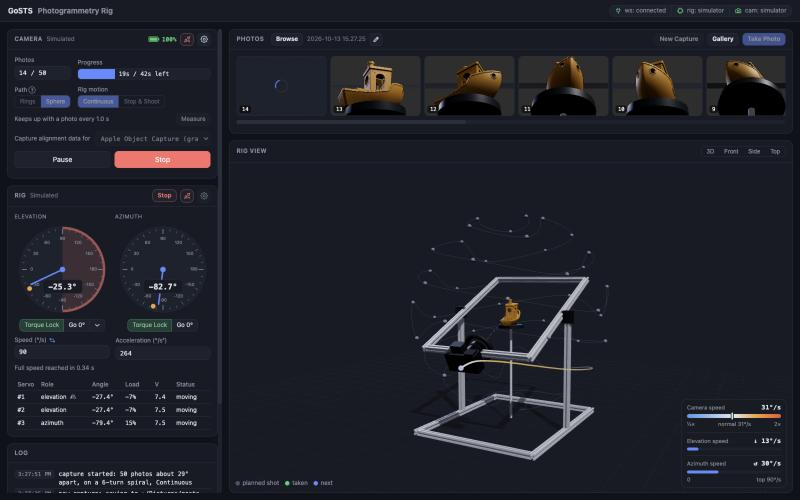

# Go ST Servo: Photogrammetry Rig

Runs a turntable photogrammetry rig from the browser: plan a capture, watch the rig move in 3D, and get the photos
straight off the camera. An example app of [Go ST Servo](../../README.md).

<p align="center"></p>

## The rig

- Based on aluminum extrusion profiles
- Two ST3215 servos on the posts tilt a frame carrying the camera
- One ST3215 turns the platform under the target object
- A camera on USB that [gphoto2](http://gphoto.org) can drive

No hardware? Simulators are available for both the rig and the camera.

## Install and run

```bash
brew install gphoto2                        # for a real camera
go install github.com/frifox/gosts/cmd/gosts-rig@latest

gosts-rig                                   # then open http://localhost:8081
gosts-rig --rig sim --camera sim            # simulated rig and camera
gosts-rig --listen :9000                    # another port (or "localhost:9000" to keep it to this computer)
```

## First time

1. Set up the servos with [gosts-ctl](../gosts-ctl) first: IDs, tuning, and zero (elevation 0° = camera level with
   the object, azimuth 0° = the platform's front). Close it after: only one program can use the serial port.
   Once the rig is connected, the same console is in gosts-rig too: the **gear** in the Rig card's title opens it as
   **Servo Settings**, the right side's only card, on the rig's board, with gosts-ctl's settings (names, groups, …).
2. In gosts-rig, **Setup** picks which servo does what (by default #1 and #2 elevation, #3 azimuth).
3. The rig itself is fixed: the base 600 × 500 mm, 400 mm side posts, the swing 600 × 450 mm, a 100 mm turntable and object, the turntable as high as puts the object's middle on the tilt axis, and the camera's sensor 335 mm out with its lens in line with it. The Rig card's two dials, elevation and azimuth, show where the rig is (the needle) and where it's going (the dot); click or drag on one to move there, or **Go 0°** below it; beside that, each axis' **Torque Lock** (off: its servos let go, to move by hand). The chevron beside the elevation's Go 0° shows (or hides) **Set Min** and **Set Max**, which save where the camera is now as its lowest or highest elevation. The ✕ beside them clears both (the whole −90° to 90°). The elevation's out-of-limits angles are shaded red: a move there stops at the nearest limit.
4. Set the camera to **RAW & JPEG** (on a Sony in PC Remote: save to PC+Camera). The RAWs stay on the card,
   and only the JPEGs come over USB.

## Taking photos

- In the **Camera** card, choose how many photos you want. They're spread evenly round the object, as high and low as the
  camera may go.
- **Path**: **Rings** (the default) takes the photos in rings, the camera's height changing only between rings
  (fewer photos in the higher rings): best for photogrammetry (RealityScan, Metashape, Apple Object Capture).
  **Sphere** spreads them as evenly as can be round the object: best for Gaussian splatting and NeRF.
- **Rig motion**: **Continuous** doesn't stop: the rig
  glides along one smooth path, taking each photo as it passes, which is much faster, for a quick enough shutter. Any
  number of photos works; on long spirals the rig pauses for a moment now and then to reset the platform servo's turn
  count. **Stop & Shoot** stops at each shot and waits the settle time before the photo, and after it keeps still
  while the shutter's open (the camera's shutter speed, read as the capture starts, and 0.1 s to spare from 1/15 s on).
- **Measure** (under the choices) times a few quick sample shots to find how often your camera keeps up (an A6600
  shooting RAW + JPEG: about one every 1.2 s). Continuous spaces the photos at least that far apart, never fires
  while the camera is still busy with the last one, and slows down (holding still at 4 photos waiting) if the
  camera falls behind anyway, so no photo is lost.
- **Capture alignment data for** (above the buttons; None writes nothing, All every format below): when a capture ends, writes where each photo was taken from
  (the rig's poses, as starting points the app refines) beside the photos, for: Agisoft Metashape
  (`alignment-metashape.csv`: File → Import → Import Reference), RealityScan / RealityCapture (an `.xmp` per
  photo), Nerfstudio / Gaussian splatting (`transforms.json`), COLMAP (a text model in `colmap/`), or Apple Object
  Capture / PhotoCatch (`gravity.json`: Apple takes no poses, only which way is down, through a tool that passes it
  on). Works best with a plain backdrop (the object turns, not the camera).
- **Simulate** plays the capture in the 3D view first, without moving the rig.
- **Capture** takes the photos: while it runs, it turns into **Stop** and Preview into **Pause** (Resume). The
  progress bar shows the photos done, the time so far and about how long is left (and before you start, an
  estimate of the whole capture: from the moves at the rig's speed, the settle time and the camera's measured pace).
- **Take Photo** takes a single photo where the rig is.

Photos appear in the **Photos** card as they arrive. Click one to see it full size (drag to move it, the wheel or the
navigator at the bottom right to zoom, up to 200% of its own pixels), **View All** for a grid. They're
saved in `~/Pictures/gosts-rig/`, a folder per batch named after its start time. **Reset** starts a new batch.
**Browse** opens the captures saved there (sample shots' folders left out), newest first, each with its middle photo,
name and count, as thumbnails or a list: open one to see its photos (← → to step through them large); the pencil on a
capture (on hover) renames its folder.

## Camera settings

The **gear** in the Camera card's title opens the camera's settings next to a sample shot, in a Settings card in place
of Photos and Rig View (✕, Esc or the gear again closes it; the Rig card's gear opens Servo Settings the same way, in place of both).

- Zoom (on a camera that zooms by remote, with a power zoom lens; the A6600 doesn't: zoom on the camera), focus,
  shutter, f-stop, ISO and white balance, applied as
  you change them. **Show Live Preview** shows the camera's live view as you change them, or **Take Sample Shot**
  how they look (the live view is lower resolution: use a sample shot to check focus or use the gray card). The zoom
  can't change during a capture; its focal length goes into the alignment data for the apps that take one
  (RealityScan, Nerfstudio, COLMAP).
- **Pause for X minutes after Y shots** (below the buttons): a flash that gets hot gets a rest. During a capture,
  after every Y photos it pauses X minutes (the note counts down), then carries on by itself; **Resume** carries on
  sooner. The estimate includes the pauses.
- **Gray Card** (with white balance on a color temperature): drag a box over a gray card in the sample. It
  suggests the color temperature and color shifts that make the card neutral, a button each to apply.
- **Focus** (in Manual focus) offers two ways, then **Start**:
  - **Single Point**: drag a box over the part that matters to see it large. **Auto** focuses on that part for you;
    the arrows nudge the focus nearer or further.
  - **Near/Far Points**: put two printed contrast cards where the object comes nearest and farthest over a full
    turn, then drag a box round the near card and one round the far card. **Focus between** steps the lens through
    both cards' sharpest and leaves it where they're equally sharp: the depth of field centred between them. If the
    depth of field doesn't reach both cards, it says so: stop down (a higher f-number) or zoom out, and try again.

  Focus stays where you leave it for the capture.

## Tips

- *"Another program has the camera"* (macOS): quit Photos and Image Capture, then run
  `killall ptpcamerad mscamerad-xpc`.
- Use **Manual** focus for captures: in an autofocus mode the camera won't fire until it has found focus.
- The camera's battery level is shown in the Camera card's title, next to the gear.

Settings are kept in `~/Library/Application Support/gosts-rig/config.toml` on macOS (`~/.config/gosts-rig/` on
Linux); `--config` picks another file.
